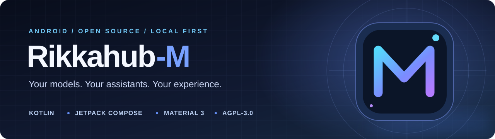

  

<h1 align="center">Rikkahub-M</h1>

  <strong>模型自己选，助手自己定，数据自己管。</strong> 
  原生模型直连 · 本地助手与提示词 · 聊天与长期记忆 · 加密备份

  
  
  

  <strong>简体中文</strong> · <a href="README_EN.md">English</a> · <a href="README_ZH_TW.md">繁體中文</a>

  <a href="https://github.com/cs9527h/Rikkahub-M/releases"><strong>下载安装包</strong></a>　·　
  <a href="CHANGELOG_MATE.md">更新日志</a>　·　
  <a href="docs/MATE_USER_GUIDE.md">使用指南</a>　·　
  <a href="docs/HISTORY_MEMORY.md">历史记忆</a>　·　
  <a href="docs/RM_VS_RB.md">与上游的差异</a>　·　
  <a href="https://github.com/cs9527h/Rikkahub-M/issues">反馈问题</a>

---

<!-- RELEASE-BLOCK:BEGIN -->
> **最新正式版：v1.1.6**（2026-11-27，commit `cddb5bee`）
>
> 安装包：[Rikkahub-M-1.1.6.apk](https://github.com/cs9527h/Rikkahub-M/releases/download/v1.1.6/Rikkahub-M-1.1.6.apk) · 18.0 MB · universal（arm64-v8a + x86_64）
>
> SHA-256：`a845185bc145efb777c1b8717ce557a25d1cff702e3fc19cbf37b4a8cf0b5813`
>
> 本版摘要：头像独立管理，修复图片归属延迟、头像替换与备份缺图。
>
> 完整说明见 [v1.1.6 更新日志](docs/releases/1.1.6.md)。
<!-- RELEASE-BLOCK:END -->

## 这是什么

Rikkahub-M 是基于 [RikkaHub](https://github.com/rikkahub/rikkahub) 的**独立维护开源 Android AI 客户端**，使用 Kotlin + Jetpack Compose + Material 3 Expressive。聊天走你配置的原生模型 API，不需要旧版 Mate/AstrBot 网关、设备配对或云端人格注入。

## 核心功能

- **多模型直连**：OpenAI 兼容、DeepSeek、Gemini 兼容、Claude 兼容、NewAPI 类中转与自定义地址，模型列表与错误信息如实呈现。
- **本地助手**：自定义名称、头像、人格提示词与模型绑定；不改动你已有的助手配置。
- **提示词注入**：`.md` / `.txt` / `.json` 导入，可编辑优先级、注入位置与助手绑定。
- **聊天与记忆**：会话历史、搜索、消息操作；本地长期记忆的提取、编辑、删除与召回。
- **备份与恢复**：单页备份、免手输口令、Keystore 恢复密钥、自动备份、本地 / WebDAV / S3。
- **安全更新**：GitHub → Atom → 国内备用源 → 缓存回退；SHA-256、包名、版本码、签名四重校验后才交给系统安装器。

## 当前状态

- 可自动验证的部分（编译、单元测试、模拟器仪器测试、Lint、签名与 universal APK 校验、历史版本覆盖升级数据契约）每次发布都会跑。
- **未做真机验收的部分会明确标注**：通知栏下载进度与取消、切后台下载、安装授权返回后续装、安全模式导出导入、备份跨设备恢复、真机性能指标。
- 性能数字只在有真机测量时公布，仓库里没有推测的提升百分比。

## 与上游的区别

- 保留上游原生能力与设计语言，不引入赞助、捐赠、推广服务商。
- 独立包名 `com.rikkahub.mate`、独立签名与发布链，只发单一 universal APK。
- 备份与更新系统按本项目使用者反馈重做：单页备份 + 免口令 + 四重校验安装。
- 差异清单与逐文件对照见 [docs/RM_VS_RB.md](docs/RM_VS_RB.md)、[docs/RM_VS_RB_FILE_DIFF.md](docs/RM_VS_RB_FILE_DIFF.md)。

## 文档

- [使用指南](docs/MATE_USER_GUIDE.md)
- [更新日志](CHANGELOG_MATE.md) · [版本说明](docs/releases/)
- [质量与需求台账](docs/QUALITY_LEDGER.md)
- [备份与架构说明](docs/STANDALONE_BACKUP_ONLY.md)

## 版权与许可

本项目以 [AGPL-3.0](LICENSE) 发布，保留上游 RikkaHub 版权与署名。分发修改版本时同样需要遵守 AGPL-3.0。
