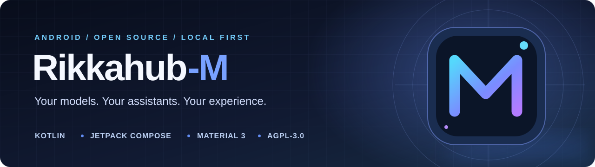

  

<h1 align="center">Rikkahub-M</h1>

  <strong>Your models. Your assistants. Your data.</strong> 
  Direct model APIs · local assistants and prompts · chat and long-term memory · encrypted backups

  
  
  

  <a href="README.md">简体中文</a> · <strong>English</strong> · <a href="README_ZH_TW.md">繁體中文</a>

  <a href="https://github.com/cs9527h/Rikkahub-M/releases"><strong>Download</strong></a>　·　
  <a href="CHANGELOG_MATE.md">Changelog</a>　·　
  <a href="docs/MATE_USER_GUIDE.md">User guide</a>　·　
  <a href="docs/RM_VS_RB.md">Differences from upstream</a>　·　
  <a href="https://github.com/cs9527h/Rikkahub-M/issues">Issues</a>

---

<!-- RELEASE-BLOCK:BEGIN -->
> **Latest stable release: v0.8.0** (2026-11-22, commit `e1cebf8c`)
>
> APK: [Rikkahub-M-0.8.0.apk](https://github.com/cs9527h/Rikkahub-M/releases/download/v0.8.0/Rikkahub-M-0.8.0.apk) · 18.5 MB · universal (arm64-v8a + x86_64)
>
> SHA-256: `fbde737d27de7def8f485a289e476ece8d2e1d536db01337bf89023fd2cda07e`
>
> Summary: see the release notes for this version.
>
> Details: [v0.8.0 release notes](docs/releases/0.8.0.md).
<!-- RELEASE-BLOCK:END -->

## What is this

Rikkahub-M is an **independently maintained open-source Android AI client** forked from [RikkaHub](https://github.com/rikkahub/rikkahub), built with Kotlin, Jetpack Compose and Material 3 Expressive. Chats go directly to the model APIs you configure — no legacy Mate/AstrBot gateway, device pairing or cloud persona injection.

## Core features

- **Bring your own models**: OpenAI-compatible, DeepSeek, Gemini-compatible, Claude-compatible, NewAPI-style relays and custom endpoints. Model lists and API errors are reported as they are.
- **Local assistants**: custom name, avatar, persona prompt and model binding; your existing assistant configuration is never rewritten.
- **Prompt injection**: import `.md` / `.txt` / `.json`, edit priority, injection position and assistant binding.
- **Chat and memory**: conversation history, search, message actions; local long-term memory extraction, editing, deletion and recall.
- **Backup and restore**: single-page backup, no manual passphrase, Keystore-backed recovery key, automatic backup, local / WebDAV / S3.
- **Safe updates**: GitHub → Atom → China mirror → cache fallback; SHA-256, package name, version code and signature are all verified before handing the APK to the system installer.

## Project status

- Automated gates run on every release: compile, JVM unit tests, emulator instrumented tests, Android Lint, signature and universal-APK checks, and the historical-version upgrade data contract.
- **Anything not verified on a physical device is labelled as such**: notification progress and cancel, background download, install-permission return, safe-mode export/import, cross-device restore, and real-device performance numbers.
- Performance figures are published only when measured on a device; this repository contains no estimated percentages.

## Differences from upstream

- Keeps upstream native capabilities and design language; no sponsorships, donations or promoted providers.
- Independent package name `com.rikkahub.mate`, independent signing and release chain, one universal APK only.
- Backup and update systems are rebuilt around this project's feedback: single-page backup, no passphrase prompt, four-step verified install.
- See [docs/RM_VS_RB.md](docs/RM_VS_RB.md) and [docs/RM_VS_RB_FILE_DIFF.md](docs/RM_VS_RB_FILE_DIFF.md).

## Documentation

- [User guide](docs/MATE_USER_GUIDE.md)
- [Changelog](CHANGELOG_MATE.md) · [Release notes](docs/releases/)
- [Quality ledger](docs/QUALITY_LEDGER.md)
- [Backup and architecture notes](docs/STANDALONE_BACKUP_ONLY.md)

## License

Released under [AGPL-3.0](LICENSE), retaining upstream RikkaHub copyright and attribution. Modified distributions must comply with AGPL-3.0 as well.
