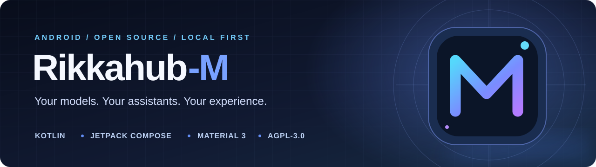

  

<h1 align="center">Rikkahub-M</h1>

  <strong>模型自己選，助手自己定，資料自己管。</strong> 
  原生模型直連 · 本地助手與提示詞 · 聊天與長期記憶 · 加密備份

  
  
  

  <a href="README.md">简体中文</a> · <a href="README_EN.md">English</a> · <strong>繁體中文</strong>

  <a href="https://github.com/cs9527h/Rikkahub-M/releases"><strong>下載安裝包</strong></a>　·　
  <a href="CHANGELOG_MATE.md">更新日誌</a>　·　
  <a href="docs/MATE_USER_GUIDE.md">使用指南</a>　·　
  <a href="docs/RM_VS_RB.md">與上游的差異</a>　·　
  <a href="https://github.com/cs9527h/Rikkahub-M/issues">回報問題</a>

---

<!-- RELEASE-BLOCK:BEGIN -->
> **最新正式版：v0.8.8**（2026-11-23，commit `c4ba1578`）
>
> 安裝包：[Rikkahub-M-0.8.8.apk](https://github.com/cs9527h/Rikkahub-M/releases/download/v0.8.8/Rikkahub-M-0.8.8.apk) · 18.6 MB · universal（arm64-v8a + x86_64）
>
> SHA-256：`066aa3e2c6c7aba73a3c5d36237ce6634d8ac153af81cce9a8a6e315b6a4bb9d`
>
> 本版摘要：聊天顶部不再泛白、消息栏更简洁、设置说明更短。
>
> 完整說明見 [v0.8.8 更新日誌](docs/releases/0.8.8.md)。
<!-- RELEASE-BLOCK:END -->

## 這是什麼

Rikkahub-M 是基於 [RikkaHub](https://github.com/rikkahub/rikkahub) 的**獨立維護開源 Android AI 用戶端**，使用 Kotlin + Jetpack Compose + Material 3 Expressive。聊天直接連你設定的原生模型 API，不需要舊版 Mate/AstrBot 閘道、裝置配對或雲端人格注入。

## 核心功能

- **多模型直連**：OpenAI 相容、DeepSeek、Gemini 相容、Claude 相容、NewAPI 類中轉與自訂位址，模型清單與錯誤訊息如實呈現。
- **本地助手**：自訂名稱、頭像、人格提示詞與模型綁定；不會改寫你既有的助手設定。
- **提示詞注入**：`.md` / `.txt` / `.json` 匯入，可編輯優先級、注入位置與助手綁定。
- **聊天與記憶**：工作階段歷史、搜尋、訊息操作；本地長期記憶的擷取、編輯、刪除與召回。
- **備份與還原**：單頁備份、免手動輸入口令、Keystore 還原金鑰、自動備份、本地 / WebDAV / S3。
- **安全更新**：GitHub → Atom → 國內備用來源 → 快取退回；SHA-256、套件名、版本碼、簽章四重驗證後才交給系統安裝程式。

## 目前狀態

- 可自動驗證的部分（編譯、單元測試、模擬器儀器測試、Lint、簽章與 universal APK 驗證、歷史版本覆蓋升級資料契約）每次發佈都會執行。
- **未於實機驗證的項目會明確標註**：通知列下載進度與取消、背景下載、安裝授權返回後續裝、安全模式匯出匯入、跨裝置還原、實機效能數據。
- 效能數字只在有實機量測時公佈，倉庫內沒有推測的提升百分比。

## 與上游的差異

- 保留上游原生能力與設計語言，不引入贊助、捐贈、推廣服務商。
- 獨立套件名 `com.rikkahub.mate`、獨立簽章與發佈流程，只發佈單一 universal APK。
- 備份與更新系統依本專案使用者回饋重做：單頁備份 + 免口令 + 四重驗證安裝。
- 差異清單與逐檔對照見 [docs/RM_VS_RB.md](docs/RM_VS_RB.md)、[docs/RM_VS_RB_FILE_DIFF.md](docs/RM_VS_RB_FILE_DIFF.md)。

## 文件

- [使用指南](docs/MATE_USER_GUIDE.md)
- [更新日誌](CHANGELOG_MATE.md) · [版本說明](docs/releases/)
- [品質與需求台帳](docs/QUALITY_LEDGER.md)
- [備份與架構說明](docs/STANDALONE_BACKUP_ONLY.md)

## 版權與授權

本專案以 [AGPL-3.0](LICENSE) 發佈，保留上游 RikkaHub 版權與署名。散佈修改版本時同樣需要遵守 AGPL-3.0。
